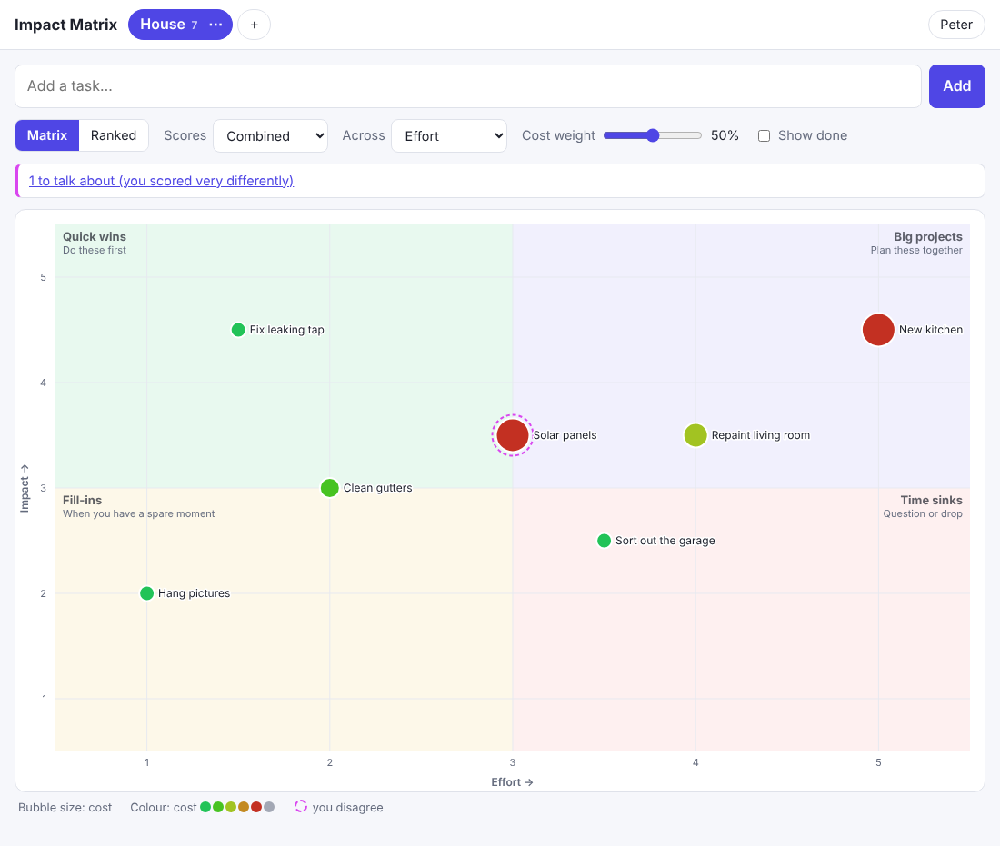
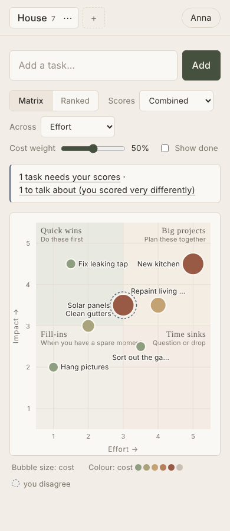
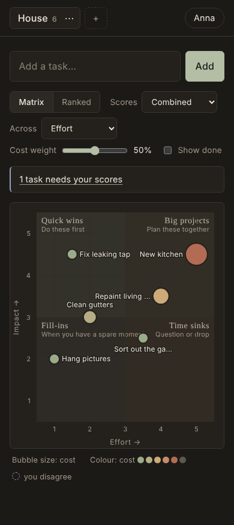

# Impact Matrix

A small web app for shared to-do lists that you and your partner score together.
Each task gets three 1–5 scores **from each of you**:

| Dimension | 1 | 5 |
|-----------|---|---|
| **Impact** | Tiny | Huge |
| **Effort** | Minutes | Weeks |
| **Cost**   | Free | Expensive |

You can also note an estimated cost in money (€ by default).

  

## What you get

- **Matrix view**: impact on the vertical axis. The horizontal axis can be *Effort*, *Cost*
  or a blend of both. Bubble colour shows cost (green = cheap, red = expensive) and bubble
  size shows cost (or effort when cost is on the axis). The four quadrants are
  Quick wins, Big projects, Fill-ins and Time sinks.
- **Ranked view**: tasks sorted by priority = impact ÷ (blend of effort and cost).
  The **Cost weight** slider sets how much cost counts against effort
  (0% = ignore cost, 100% = cost only).
- **Separate scores**: everyone scores on their own. *Combined* averages them, and you can
  also look at the matrix through just your scores or just your partner's.
- **Prompts**: a banner shows tasks you haven't scored yet, and tasks where your scores
  differ by 2 or more (a dashed pink ring marks them as worth talking about).
- **Several lists** (House, Garden, Holiday…) with live sync: a change on one phone shows up
  on the other right away.
- Calm Japandi styling (linen, ink and earth tones) that works on phones, has a dark mode
  and can be added to the home screen.

## Hosted on claude.ai (no server needed)

`artifact/impact-matrix.html` is the app as a single claude.ai Artifact page. It is the
version in active use and has a few extras the self-hosted app doesn't have yet: lists are
called **missions**, tasks can have **owners**, a shared **Next up** shortlist holds at most
three tasks (with suggestions from the current mission), task rows show effort as time
(Minutes, Hours, Days, Weeks, Months) and cost in words with the € estimate.
**Import** takes text pasted from a doc or note (one task per line; bullets, checkboxes and
headings are stripped, and amounts like "€250" become the cost estimate), rows copied from
Google Sheets or Excel, or a .csv/.tsv/.txt/.md file. Columns named Task, Notes, Cost, Owner
and Done (also in Dutch, German and French) are recognised. A preview lets you untick tasks;
ones already done or already in the mission start unticked. Your lists
are kept in the artifact's shared database, and each person is recognised by their Claude
login. Share it by email with **Editor** access, and don't also turn on a public link:
people invited from outside your account can only make changes while there is no public link.

## Running it yourself

Requires Node.js 18+. There are no dependencies to install.

```bash
cd impact-matrix
APP_PASSCODE="something-only-you-two-know" npm start
# → http://localhost:3000
```

The first time each of you opens it on your own device, enter the passcode and pick or add
your name. Data is stored in `data/db.json`. Back up that file to keep your lists safe.

| Variable | Default | Purpose |
|----------|---------|---------|
| `PORT` | `3000` | HTTP port |
| `APP_PASSCODE` | *(none)* | Shared passcode. **Set this** if the app is reachable from the internet |
| `DATA_FILE` | `data/db.json` | Where lists are stored |
| `CURRENCY` | `€` | Symbol shown next to cost estimates |
| `SECURE_COOKIE` | *(off)* | Set to `1` when serving over HTTPS |

### Sharing it between two phones

Both of you need to reach the same server. Some options:

- **At home only**: run it on any always-on machine (a Raspberry Pi or NAS) and open
  `http://<machine-ip>:3000` on both phones while on your Wi-Fi.
- **From anywhere, privately**: the same, plus [Tailscale](https://tailscale.com) on the
  server and both phones.
- **Hosted**: deploy the Docker image to Fly.io, Railway, Render or a VPS. Mount a
  persistent volume at `/data` and set `APP_PASSCODE` and `SECURE_COOKIE=1`:

  ```bash
  docker build -t impact-matrix .
  docker run -d -p 3000:3000 -v impact-data:/data \
    -e APP_PASSCODE=... -e SECURE_COOKIE=1 impact-matrix
  ```

## Development

```bash
npm test   # API and scoring tests (node:test)
```

- `server.js`: HTTP server, JSON API, live updates (server-sent events), passcode check
- `store.js`: validation and storage in a JSON file with atomic writes
- `public/`: the front end (plain HTML, CSS and JavaScript modules; no build step)
- `public/scoring.js`: the scoring maths, shared by the browser and the tests
